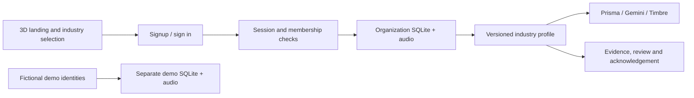
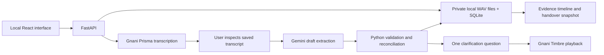

# Architecture and invariants

The organization-account expansion is documented in [the release report](organizations-release.md). New account routes use revocable cookie sessions and an identity SQLite database. Membership is resolved before opening an explicit organization repository/audio directory. Organization jobs carry that repository into processing; the global demo repository is never used for account data. Manufacturing, maintenance and warehouse profiles provide separate schema constraints and readiness rules; five industries remain setup-only previews.

The existing manufacturing engine and evaluation diagrams below describe the original core. Their benchmark results do not establish accuracy for the new industries.

AWS work is paused. The existing SAM/SQS/DynamoDB implementation remains in the repository but was not deployed for this upgrade. Local background tasks are intended for one developer, not a production queue substitute.

## Data and review flow

Notes have immutable recording metadata, a server-authenticated actor, received time, optional correction references and a frozen clarification question with source references, and append-only transcript versions. Extraction validates exact excerpts against the relevant transcript. Candidate values use a small domain schema: packing, quality, dispatch, quantity, and task. Negative wording is preserved as metadata while its normalized value reflects the meaning.

The engine derives a view from active claims. Superseded and rejected reports remain stored. A strictly older quantity observation is historical only when a newer human-reviewed actual quantity exists from the same reporter, with explicit observation times. Planned, conditional or mismatched claims do not hide actual reports. Quality holds persist until explicit authorized rejection or property-specific supersession. Unreviewed notes, conditions, conflicts, and missing verification prevent a verified batch state.

Review uses an expected workspace version. It validates role, correction targets, time ordering, and conflict coverage, then commits the resolution and claim changes atomically. Updating an owner or task completion records a separate reviewer action. Handover acknowledgements store the exact immutable snapshot they bind to and become stale after material updates. Playback, repeated processing and duplicate delivery do not themselves invalidate them. They can acknowledge unresolved work but cannot acknowledge unfinished processing.

## Storage consistency

SQLite stores the aggregate in a single row under `BEGIN IMMEDIATE`. Cloud DynamoDB stores individual entity documents under one workspace partition. A metadata revision protects each transaction. Readers check that revision before and after the paginated query; writers conditionally advance it and update changed records in one transaction. The material handover version is distinct from the persistence revision: usage counters and acknowledgement writes do not invalidate a handover.

This is intentionally one fictional workspace. DynamoDB transactions are limited to 99 changed entity records plus metadata. A future multi-factory deployment requires tenant isolation, per-tenant partitions, bounded history queries, and private evidence authorization before using real data.

## Failure handling

- Audio uploads use a signed URL with `If-None-Match: *` in cloud mode; keys are unique to a note. Validation rejects unsupported channels, PCM widths, sizes, and durations.
- SQS messages can repeat. Completed notes return without new claims, and note/revision-based IDs prevent duplicate entities.
- A processing lease prevents concurrent processing. The STT transcript is checkpointed before extraction to avoid unnecessary re-transcription on retry.
- Provider failures save a readable error and retain evidence. Exactly two network attempts are shared between a transient retry and invalid-output repair. Quota/auth failures are explicit and do not retry inside the attempt; exhausted processing remains available for manual review.
- DynamoDB write conflicts return a retryable conflict. A stale human review returns HTTP 409 rather than overwriting another reviewer.
- Failure after an external provider call but before checkpointing can duplicate billing. The app limits calls but does not claim external exactly-once execution.

## Interfaces

Note responses expose processing_stage, failed_stage, error_category, timings and provider provenance; older records use optional defaults. /config reveals provider readiness and the matching model/configuration smoke receipt without secrets or network calls. GET /shifts/shift-B/snapshots/{version} retrieves an acknowledged snapshot. POST /notes/{id}/process accepts transcribe_only=true to stop for transcript inspection.

The FastAPI OpenAPI document at `/docs` describes request models. Main endpoints are `/notes`, `/notes/{id}/process`, `/notes/{id}/revisions`, `/claims/{id}/resolve`, `/tasks/{id}`, `/shifts/shift-B/handover`, `/shifts/shift-B/acknowledgements`, and `/questions`.

Cloud access tokens are checked for Cognito issuer, signature, expiry, token use, client ID, and group. Client-supplied role headers are ignored. Scripted notes are data, never instructions or authority.

`POST /notes` accepts optional `clarification_version`; a stale displayed version is rejected before note creation or provider work. The browser retains the recording/text and asks the user to explicitly refresh the question. `/questions` preserves `answer`, `claim_ids` and `abstained`, adding individual evidence-linked `items` and the comparison snapshot. Each readiness reason exposes a next action and owner or an explicit unknown assignment. Completing an inspection task does not clear its quality hold.

The live Gemini adapter consumes REST `model_output` steps, not the SDK-only `output_text` convenience. Prompt/model/request provenance is persisted per note; missing provider IDs remain absent. Smoke receipts are bound to model, credential configuration, free-tier assertion, extraction prompt and schema. Runtime extraction never silently selects another model.
